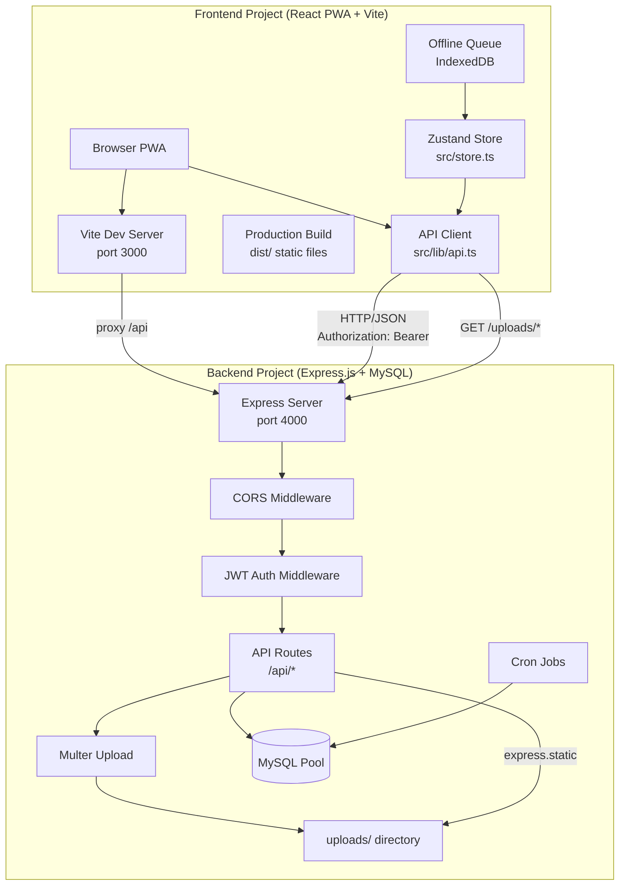
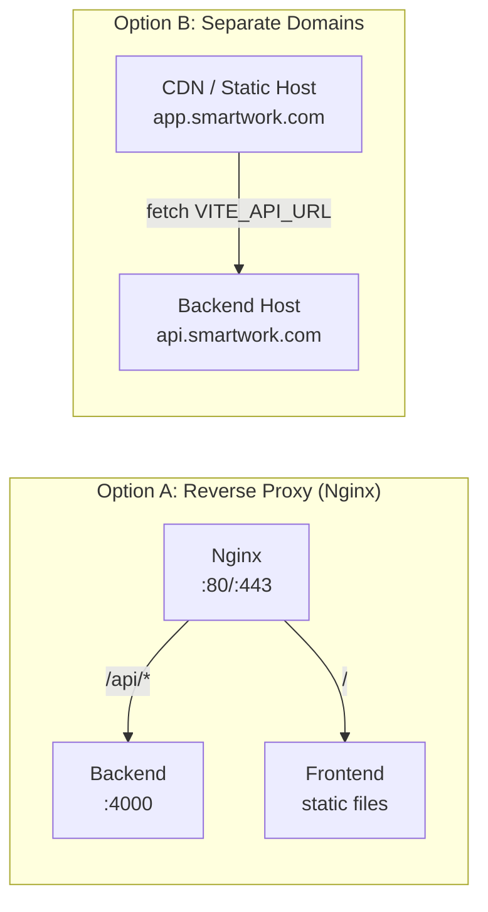
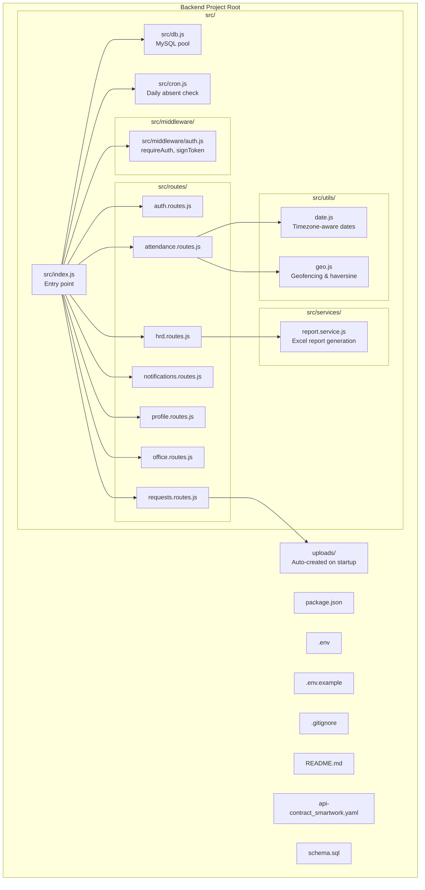
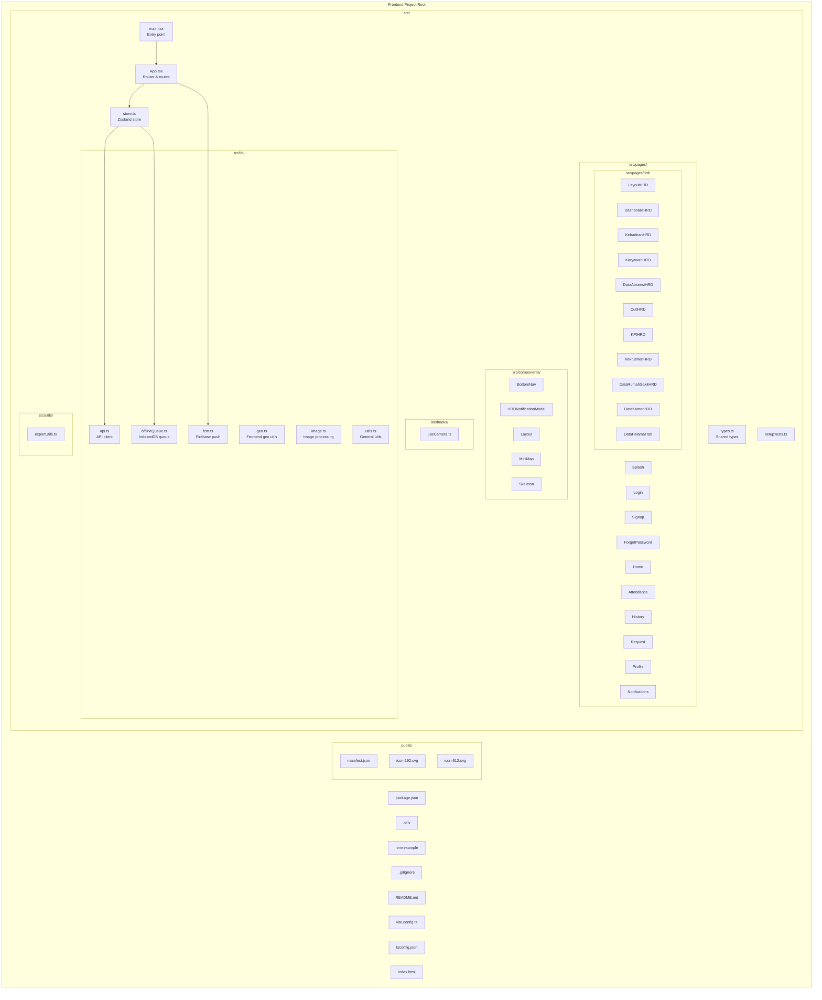

# Design Document: Backend-Frontend Separation

## Overview

This design document describes the architecture for separating the SmartWork (PWA Absen CTI) application from a single monorepo into two independent, self-contained projects:

1. **Backend Project** — Express.js + MySQL API server
2. **Frontend Project** — React PWA + Vite

Currently both codebases live together with a shared `package.json`, shared `.env`, and the backend serving static files for the frontend. The separation gives each project its own repository, dependency tree, environment configuration, build pipeline, and deployment lifecycle while preserving all existing functionality and the HTTP API contract.

The core challenge is severing three shared concerns:
- **Dependencies**: the single `package.json` mixes frontend (React, Vite, Leaflet) and backend (Express, MySQL, Multer) packages.
- **Environment**: the single `.env` mixes `DB_*`, `JWT_*`, `EMAIL_*` (backend-only) with `VITE_API_URL` (frontend-only).
- **Static files**: the backend currently serves the frontend's `public/` directory including user uploads at `/uploads/`. After separation, the backend serves only `uploads/` and the frontend is built and served independently.

### Design Decisions and Rationales

| Decision | Rationale |
|----------|-----------|
| Backend serves `uploads/` at `/uploads/`, not `public/` | After separation the backend has no reason to serve the frontend's static assets. Uploads are the only files the backend needs to serve. The frontend constructs full URLs via `VITE_UPLOADS_BASE_URL`. |
| CORS configured via `CORS_ORIGIN` env var | The frontend and backend will run on different origins in development and potentially different domains in production. The backend needs configurable CORS instead of the current `cors()` (allow-all). |
| Frontend retains Vite proxy for dev | When `VITE_API_URL=/api` (default), the Vite dev server proxies `/api` to `http://localhost:4000`. This avoids CORS issues during local development. |
| `VITE_UPLOADS_BASE_URL` defaults from `VITE_API_URL` | Reduces configuration burden. If the API is at `http://localhost:4000/api`, uploads are at `http://localhost:4000`. The default strips the `/api` suffix. |
| OpenAPI spec lives in backend | The backend is the API provider and the authoritative source for the API contract. The frontend types (`types.ts`) remain the frontend's own source of truth for response shapes. |
| No shared types package | The requirements specify `types.ts` stays in the frontend as the single source of truth. Adding a shared npm package would add complexity beyond what the requirements call for. |

## Architecture

### High-Level Architecture



### Communication Flow

The two projects communicate exclusively via HTTP/JSON. There are no shared code modules, no shared types package, and no direct file system access between them.

**Development flow:**
1. Backend runs on `http://localhost:4000`
2. Frontend Vite dev server runs on `http://localhost:3000`
3. `VITE_API_URL` defaults to `/api`, so the browser requests `/api/...`
4. Vite proxy forwards `/api` requests to `http://localhost:4000` with `changeOrigin: true`
5. No CORS issues because the browser sees same-origin requests

**Production flow:**
1. `VITE_API_URL` is set to the backend's public URL (e.g., `https://api.smartwork.com/api`)
2. Frontend is built to `dist/` and served by a static file server or CDN
3. Backend runs as a Node.js process, CORS configured via `CORS_ORIGIN`
4. Reverse proxy (Nginx) can route `/api/*` to backend and `/` to frontend static files

### Deployment Topology



## Components and Interfaces

### Backend Project Components



#### Backend Entry Point (`src/index.js`)

The entry point changes from the current `server/index.js` in several ways:

```javascript
import "dotenv/config";
import express from "express";
import cors from "cors";
import path from "path";
import fs from "fs";
import { testConnection } from "./db.js";
import { requireAuth } from "./middleware/auth.js";
// ... route imports with updated relative paths (./routes/...)
import { initCron } from "./cron.js";

// CORS configuration from env var
const corsOrigin = process.env.CORS_ORIGIN || "*";
const corsOptions = {
  origin: corsOrigin === "*" ? true : corsOrigin.split(",").map(s => s.trim()),
  allowedHeaders: ["Authorization", "Content-Type"],
  methods: ["GET", "POST", "PUT", "PATCH", "DELETE", "OPTIONS"],
};

const app = express();
app.use(cors(corsOptions));
app.use(express.json({ limit: "20mb" }));

// Static file serving for uploads only (not public/)
const uploadsDir = process.env.UPLOADS_DIR || "uploads";
const uploadsPath = path.resolve(uploadsDir);
if (!fs.existsSync(uploadsPath)) {
  fs.mkdirSync(uploadsPath, { recursive: true });
}
// Ensure uploads/requests/ subdirectory exists
const requestsDir = path.join(uploadsPath, "requests");
if (!fs.existsSync(requestsDir)) {
  fs.mkdirSync(requestsDir, { recursive: true });
}
app.use("/uploads", express.static(uploadsPath));

app.get("/api/health", (req, res) => res.json({ status: "ok" }));

// Route mounting (same /api/* prefix as before)
app.use("/api/auth", authRoutes);
app.use("/api/attendance", requireAuth, attendanceRoutes);
// ... other routes

// Global error handler (preserved from current code)
app.use((err, req, res, next) => {
  if (err.type === "entity.too.large" || err.status === 413) {
    return res.status(413).json({ message: "Ukuran data terlalu besar." });
  }
  console.error("Unhandled error:", err);
  res.status(500).json({ message: "Terjadi kesalahan tak terduga pada server." });
});

// Process-level error handlers (preserved)
process.on("unhandledRejection", (reason) => {
  console.error("⚠️  Unhandled Rejection:", reason);
});
process.on("uncaughtException", (err) => {
  console.error("⚠️  Uncaught Exception:", err);
});

const PORT = process.env.PORT || 4000;

async function start() {
  try {
    await testConnection();
  } catch (err) {
    console.error("❌ Gagal terhubung ke database MySQL:", err.message);
  }
  app.listen(PORT, "0.0.0.0", () => {
    console.log(`🚀 Server backend berjalan di http://localhost:${PORT}`);
    initCron();
  });
}

start();
```

#### Backend Multer Upload (`src/routes/requests.routes.js`)

The multer configuration changes to use the `UPLOADS_DIR` env var instead of the hardcoded `public/uploads/requests/` path:

```javascript
import path from "path";
import fs from "fs";

const uploadsDir = process.env.UPLOADS_DIR || "uploads";
const uploadDir = path.join(uploadsDir, "requests");

if (!fs.existsSync(uploadDir)) {
  fs.mkdirSync(uploadDir, { recursive: true });
}

const storage = multer.diskStorage({
  destination: function (req, file, cb) {
    cb(null, uploadDir);
  },
  filename: function (req, file, cb) {
    const uniqueSuffix = Date.now() + "-" + Math.round(Math.random() * 1e9);
    cb(null, uniqueSuffix + path.extname(file.originalname));
  }
});
const upload = multer({ storage });
```

The `attachmentUrl` returned in the response remains `/uploads/requests/<filename>` — a relative path that the frontend prepends with `VITE_UPLOADS_BASE_URL`.

#### Backend CORS Middleware

The current `app.use(cors())` allows all origins with no configuration. The new configuration reads from `CORS_ORIGIN`:

```javascript
const corsOrigin = process.env.CORS_ORIGIN || "*";
const corsOptions = {
  origin: corsOrigin === "*" 
    ? true  // cors() accepts boolean true for wildcard
    : corsOrigin.split(",").map(s => s.trim()),
  allowedHeaders: ["Authorization", "Content-Type"],
  methods: ["GET", "POST", "PUT", "PATCH", "DELETE", "OPTIONS"],
};
app.use(cors(corsOptions));
```

When `CORS_ORIGIN` is `*`, `origin: true` reflects the request's origin in the `Access-Control-Allow-Origin` header (equivalent to wildcard for credentialed requests). When set to specific URLs, only those origins are allowed.

#### Backend Auth Middleware (`src/middleware/auth.js`)

The `requireAuth` middleware is preserved as-is. The `signToken` function currently uses `{ sub: userId }` but the actual login routes use `{ id: user.id, role: user.role }` directly with `jwt.sign()`. This inconsistency should be resolved: the login routes should use `signToken` and the payload should consistently include `id` and `role`.

### Frontend Project Components



#### Frontend API Client (`src/lib/api.ts`)

The API client changes in one key area: constructing full URLs for uploaded files. The current code uses `API_BASE_URL` for all API requests. A new `UPLOADS_BASE_URL` is introduced for file URLs:

```typescript
const API_BASE_URL = import.meta.env.VITE_API_URL || "/api";

// Derive uploads base URL: strip "/api" suffix from API_BASE_URL if VITE_UPLOADS_BASE_URL not set
const UPLOADS_BASE_URL = import.meta.env.VITE_UPLOADS_BASE_URL 
  || API_BASE_URL.replace(/\/api\/?$/, "");

export function getUploadUrl(relativePath: string | null | undefined): string | null {
  if (!relativePath) return null;
  if (relativePath.startsWith("http")) return relativePath; // already absolute
  return `${UPLOADS_BASE_URL}${relativePath}`;
}
```

The `getToken`, `setToken`, `clearToken`, `ApiError` class, and `request<T>` function remain unchanged.

#### Frontend Offline Queue (`src/lib/offlineQueue.ts`)

The offline queue module is preserved exactly as-is. It uses IndexedDB via the `idb` library to store `CHECK_IN` and `CHECK_OUT` operations. The sync logic in `store.ts` (`processSyncQueue`) also remains unchanged.

#### Frontend Store (`src/store.ts`)

The Zustand store is preserved with one consideration: the `submitRequest` function currently constructs a `fetch` call using `import.meta.env.VITE_API_URL` directly instead of using the `request` helper. This should be refactored to use the API client pattern, but functionally it works because it reads `VITE_API_URL` the same way.

### Backend Project Directory Structure

```
backend/
├── package.json
├── .env
├── .env.example
├── .gitignore
├── README.md
├── api-contract_smartwork.yaml
├── schema.sql
├── uploads/                    # Auto-created on startup
│   └── requests/                # Auto-created on startup
└── src/
    ├── index.js                 # Express entry point
    ├── db.js                    # MySQL connection pool
    ├── cron.js                  # Daily absent check
    ├── schema.sql               # (alternative location)
    ├── middleware/
    │   └── auth.js              # JWT auth middleware
    ├── routes/
    │   ├── auth.routes.js
    │   ├── attendance.routes.js
    │   ├── requests.routes.js
    │   ├── notifications.routes.js
    │   ├── profile.routes.js
    │   ├── office.routes.js
    │   └── hrd.routes.js
    ├── services/
    │   └── report.service.js    # Excel report generation
    └── utils/
        ├── date.js              # Timezone-aware date utilities
        └── geo.js               # Geofencing & haversine
```

### Frontend Project Directory Structure

```
frontend/
├── package.json
├── .env
├── .env.example
├── .gitignore
├── README.md
├── vite.config.ts
├── tsconfig.json
├── index.html
├── public/
│   ├── manifest.json
│   ├── icon-192.svg
│   └── icon-512.svg
└── src/
    ├── App.tsx
    ├── main.tsx
    ├── store.ts
    ├── types.ts
    ├── index.css
    ├── setupTests.ts
    ├── vite-env.d.ts
    ├── pages/
    │   ├── Splash.tsx
    │   ├── Login.tsx
    │   ├── Signup.tsx
    │   ├── ForgotPassword.tsx
    │   ├── Home.tsx
    │   ├── Attendance.tsx
    │   ├── History.tsx
    │   ├── Request.tsx
    │   ├── Profile.tsx
    │   ├── Notifications.tsx
    │   └── hrd/
    │       ├── LayoutHRD.tsx
    │       ├── DashboardHRD.tsx
    │       ├── KehadiranHRD.tsx
    │       ├── KaryawanHRD.tsx
    │       ├── DataAbsensiHRD.tsx
    │       ├── CutiHRD.tsx
    │       ├── KPIHRD.tsx
    │       ├── RekrutmenHRD.tsx
    │       ├── DataRumahSakitHRD.tsx
    │       ├── DataKantorHRD.tsx
    │       └── DataPelamarTab.tsx
    ├── components/
    │   ├── BottomNav.tsx
    │   ├── HRDNotificationModal.tsx
    │   ├── Layout.tsx
    │   ├── MiniMap.tsx
    │   └── Skeleton.tsx
    ├── hooks/
    │   └── useCamera.ts
    ├── lib/
    │   ├── api.ts
    │   ├── fcm.ts
    │   ├── geo.ts
    │   ├── image.ts
    │   ├── offlineQueue.ts
    │   └── utils.ts
    ├── utils/
    │   └── exportUtils.ts
    ├── tests/
    │   └── App.test.tsx
    └── __tests__/
        ├── Attendance.test.tsx
        ├── Login.test.tsx
        └── Profile.test.tsx
```

## Data Models

### Backend Data Models (Database Schema)

The database schema remains unchanged. The `schema.sql` file is part of the backend project. Key tables:

| Table | Purpose | Key Columns |
|-------|---------|-------------|
| `users` | Employee/admin accounts | `id` (UUID), `employee_id`, `nik`, `email`, `password_hash`, `role`, `id_department`, `id_position`, `jam_masuk`, `jam_keluar`, `photo_url` |
| `attendance_records` | Daily attendance | `id` (UUID), `user_id`, `date`, `check_in_time`, `check_out_time`, `status`, `working_hours`, `hospital_id`, `check_in_lat/lng/accuracy_m/distance_m`, `check_out_lat/lng/accuracy_m/distance_m`, `check_in_photo_url`, `check_out_photo_url` |
| `requests` | Leave/permission/sick/overtime | `id` (UUID), `user_id`, `type`, `reason`, `date`, `end_date`, `status`, `attachment_url`, `rejection_reason`, `created_at` |
| `notifications` | User notifications | `id`, `user_id`, `title`, `description`, `is_read`, `created_at`, `type` |
| `offices` | Office locations for geofencing | `id`, `name`, `latitude`, `longitude`, `radius_meters` |
| `hospitals` | Hospital/field locations | `id`, `nama_rs`, `address`, `latitude`, `longitude`, `radius_meters`, `type` |
| `master_departments` | Department master data | `id`, `name`, `display_order` |
| `master_positions` | Position master data | `id`, `name` |

### DTO Transformations

The backend uses DTO functions to transform snake_case database columns to camelCase API response fields. These are critical for maintaining the API contract:

| DTO Function | Location | Input (DB row) | Output (API response) |
|---|---|---|---|
| `toUserDTO` | `auth.routes.js` | `employee_id`, `jam_masuk`, `jam_keluar`, `photo_url` | `employeeId`, `jamMasuk`, `jamKeluar`, `photoUrl` |
| `toRecordDTO` | `attendance.routes.js` | `check_in_time`, `check_in_lat`, `check_in_photo_url` | `checkInTime`, `checkInLocation`, `checkInPhotoUrl` |
| `toRequestDTO` | `requests.routes.js` | `end_date`, `attachment_url`, `rejection_reason` | `endDate`, `attachmentUrl`, `rejectionReason` |
| `toNotificationDTO` | `notifications.routes.js` | `is_read`, `created_at` | `isRead`, `createdAt` |

### Frontend TypeScript Types (`src/types.ts`)

The frontend types remain the single source of truth for API response shapes. Key types:

| Type | Matches DTO | Key Fields |
|---|---|---|
| `User` | `toUserDTO` | `id`, `employeeId`, `name`, `department`, `position`, `role`, `photoUrl`, `jamMasuk`, `jamKeluar` |
| `AttendanceRecord` | `toRecordDTO` | `id`, `date`, `checkInTime`, `checkOutTime`, `status`, `workingHours`, `checkInLocation`, `checkOutLocation`, `checkInPhotoUrl` |
| `RequestRecord` | `toRequestDTO` | `id`, `type`, `reason`, `date`, `endDate`, `status`, `attachmentUrl`, `rejectionReason` |
| `Notification` | `toNotificationDTO` | `id`, `title`, `description`, `isRead`, `createdAt`, `type` |
| `OfficeLocation` | (direct query) | `id`, `name`, `lat`, `lng`, `radiusMeters` |
| `HospitalLocation` | (direct query) | `id`, `nama_rs`, `address`, `latitude`, `longitude`, `radius_meters`, `type` |
| `Candidate` | (direct query) | `id`, `job_opening_id`, `name`, `stage` |
| `JobOpening` | (direct query) | `id`, `title`, `role`, `status` |

### API Contract

The OpenAPI specification (`api-contract_smartwork.yaml`) lives in the backend project root. All API endpoints are prefixed with `/api`. The contract defines:

| Endpoint Group | Path Prefix | Auth Required |
|---|---|---|
| Authentication | `/api/auth` | No (login/register) / Yes (me) |
| Attendance | `/api/attendance` | Yes |
| Requests | `/api/requests` | Yes |
| Notifications | `/api/notifications` | No |
| Profile | `/api/profile` | Yes |
| Office | `/api/office` | No |
| HRD | `/api/hrd` | Yes |
| Health | `/api/health` | No |
| Uploads | `/uploads/*` | No (static) |

### Environment Variable Models

#### Backend `.env`

```env
# Server
PORT=4000

# Database
DB_HOST=127.0.0.1
DB_PORT=3306
DB_USER=root
DB_PASSWORD=
DB_NAME=absensi_cti3

# JWT Auth
JWT_SECRET=<random hex string, generate with: node -e "console.log(require('crypto').randomBytes(32).toString('hex'))">
JWT_EXPIRES_IN=7d

# Geofencing
MAX_ACCURACY_METERS=75
ENABLE_GEOFENCING=false

# Email (nodemailer)
EMAIL_USER=emailcti65@gmail.com
EMAIL_PASS=<app password>

# Timezone
APP_TIMEZONE=Asia/Jakarta

# CORS
CORS_ORIGIN=*

# File Uploads
UPLOADS_DIR=uploads
```

#### Frontend `.env`

```env
# API Configuration
VITE_API_URL=http://localhost:4000/api
VITE_UPLOADS_BASE_URL=http://localhost:4000

# Firebase Config
VITE_FIREBASE_API_KEY=
VITE_FIREBASE_AUTH_DOMAIN=
VITE_FIREBASE_PROJECT_ID=
VITE_FIREBASE_STORAGE_BUCKET=
VITE_FIREBASE_MESSAGING_SENDER_ID=
VITE_FIREBASE_APP_ID=
```

## Correctness Properties

*A property is a characteristic or behavior that should hold true across all valid executions of a system — essentially, a formal statement about what the system should do. Properties serve as the bridge between human-readable specifications and machine-verifiable correctness guarantees.*

### Property 1: CORS Origin Configuration

*For any* `CORS_ORIGIN` environment variable value (single URL, comma-separated list, or `*`), the backend's CORS middleware SHALL reflect or restrict the `Access-Control-Allow-Origin` header according to the configured value, allowing requests only from configured origins.

**Validates: Requirements 3.1, 3.2, 3.3**

### Property 2: CORS Allowed Headers

*For any* preflight (OPTIONS) request to the backend, the `Access-Control-Allow-Headers` response header SHALL include both `Authorization` and `Content-Type`.

**Validates: Requirements 3.4**

### Property 3: CORS Allowed Methods

*For any* preflight (OPTIONS) request to the backend, the `Access-Control-Allow-Methods` response header SHALL include `GET`, `POST`, `PUT`, `PATCH`, `DELETE`, and `OPTIONS`.

**Validates: Requirements 3.5**

### Property 4: API Base URL Resolution

*For any* value of `VITE_API_URL` (absolute URL, relative path, or unset), the frontend API client SHALL resolve the base URL correctly: using the provided value if set, or defaulting to `/api` when unset.

**Validates: Requirements 3.6, 3.7**

### Property 5: JWT Authorization Header Inclusion

*For any* stored JWT token and any API request path, the frontend API client SHALL include the `Authorization: Bearer <token>` header in the request when a token is present in localStorage.

**Validates: Requirements 3.8, 12.4**

### Property 6: ApiError Captures Response Details

*For any* HTTP error response (varying status code, message, and error code), the `ApiError` class SHALL capture the status code, message, and optional code from the response body, allowing the UI to distinguish server error messages from network errors.

**Validates: Requirements 3.9**

### Property 7: Static File Serving for Uploads

*For any* file created in the `uploads/` directory (including subdirectories like `requests/`), the backend SHALL serve that file at the corresponding `/uploads/<path>` URL path via `express.static`.

**Validates: Requirements 4.1, 4.2**

### Property 8: Multer File Upload Returns Relative URL

*For any* file uploaded via multipart form-data to the requests endpoint, the backend SHALL save the file to the `uploads/requests/` directory and return the relative URL path `/uploads/requests/<filename>` in the response.

**Validates: Requirements 4.4**

### Property 9: Uploads URL Construction

*For any* relative upload path returned by the API and any `VITE_UPLOADS_BASE_URL` configuration (set explicitly or derived from `VITE_API_URL` by stripping the `/api` suffix), the frontend SHALL construct the correct full URL by prepending the base URL to the relative path.

**Validates: Requirements 4.5, 4.6**

### Property 10: UPLOADS_DIR Configuration Resolution

*For any* `UPLOADS_DIR` environment variable value (set or unset), the backend SHALL resolve the multer upload destination directory to the configured path, defaulting to `uploads` when unset.

**Validates: Requirements 4.7**

### Property 11: Backend Excludes VITE-Prefixed Variables

*For any* backend source file, the code SHALL NOT reference any `VITE_`-prefixed environment variables.

**Validates: Requirements 5.2**

### Property 12: Frontend Excludes Backend-Only Variables

*For any* frontend source file, the code SHALL NOT reference backend-only environment variables (`DB_HOST`, `DB_PORT`, `DB_USER`, `DB_PASSWORD`, `DB_NAME`, `JWT_SECRET`, `JWT_EXPIRES_IN`, `EMAIL_USER`, `EMAIL_PASS`).

**Validates: Requirements 5.4**

### Property 13: Backend Excludes Frontend Dependencies

*For any* frontend-only dependency name (`react`, `react-dom`, `react-router-dom`, `zustand`, `clsx`, `tailwind-merge`, `lucide-react`, `motion`, `leaflet`, `react-leaflet`, `firebase`, `idb`, `jspdf`, `jspdf-autotable`, `xlsx`, `file-saver`, `react-use`), the backend `package.json` SHALL NOT include that dependency.

**Validates: Requirements 6.1**

### Property 14: Frontend Excludes Backend Dependencies

*For any* backend-only dependency name (`express`, `cors`, `mysql2`, `bcryptjs`, `jsonwebtoken`, `multer`, `nodemailer`, `dotenv`), the frontend `package.json` SHALL NOT include that dependency.

**Validates: Requirements 6.2**

### Property 15: Shared Dependencies in Both Projects

*For any* dependency used by both projects (`date-fns`, `exceljs`), each project's `package.json` SHALL independently list that dependency.

**Validates: Requirements 6.3**

### Property 16: DTO Field Name Mapping (snake_case to camelCase)

*For any* database row with snake_case column names, the DTO transformation functions (`toUserDTO`, `toRecordDTO`, `toRequestDTO`, `toNotificationDTO`) SHALL produce an output object with camelCase field names matching the frontend `types.ts` definitions (e.g., `check_in_time` → `checkInTime`, `photo_url` → `photoUrl`, `end_date` → `endDate`).

**Validates: Requirements 8.3, 8.4**

### Property 17: Offline Queue Storage

*For any* check-in or check-out operation payload (varying lat/lng/accuracy/photoUrl), when the device is offline, the frontend SHALL store the operation in IndexedDB with the correct operation type (`CHECK_IN` or `CHECK_OUT`) and payload.

**Validates: Requirements 11.2**

### Property 18: Offline Queue Sync Success Removes Items

*For any* set of queued operations in IndexedDB, when the device comes back online and sync succeeds, all successfully synced items SHALL be removed from the IndexedDB sync queue.

**Validates: Requirements 11.3, 11.4**

### Property 19: Offline Queue Sync Failure Retains Items

*For any* queued operation that fails to sync (due to API error, network failure, etc.), the frontend SHALL log the error and retain the item in the IndexedDB sync queue for the next sync attempt.

**Validates: Requirements 11.5**

### Property 20: JWT Token Generation

*For any* user ID and role, the JWT token issued on login SHALL contain the user ID and role in its payload, be signed with `JWT_SECRET`, and expire after `JWT_EXPIRES_IN`.

**Validates: Requirements 12.1**

### Property 21: JWT Token Validation

*For any* JWT token (valid, expired, malformed, or missing), the `requireAuth` middleware SHALL allow valid tokens through (setting `req.userId` and `req.userRole`) and return HTTP 401 for missing, invalid, or expired tokens.

**Validates: Requirements 12.2**

### Property 22: 401 Response Clears Token and Redirects

*For any* API response with HTTP 401 status, the frontend SHALL clear the stored JWT token from localStorage and redirect the user to the login page.

**Validates: Requirements 12.5**

### Property 23: Session Restoration

*For any* stored JWT token state (valid token, invalid/expired token, or no token), the frontend's `hydrateSession` SHALL correctly restore the authenticated state when the token is valid, or clear the token and set the unauthenticated state when the token is invalid or missing.

**Validates: Requirements 12.6**

### Property 24: Unhandled Error Resilience

*For any* `unhandledRejection` or `uncaughtException` event, the backend process SHALL log the error and continue running without crashing.

**Validates: Requirements 10.6**

### Property 25: Cron Job Error Handling

*For any* error occurring during the daily absent check cron job execution (database failures, query errors, etc.), the cron job SHALL catch the error, log it, and continue without crashing the server process.

**Validates: Requirements 14.5**

## Error Handling

### Backend Error Handling

The backend preserves the existing multi-layer error handling strategy:

1. **Route-level try/catch**: Each route handler wraps its logic in try/catch and returns appropriate HTTP status codes (400, 401, 403, 404, 409, 413, 422, 500) with Indonesian-language error messages.

2. **Global error handler middleware**: The final `app.use((err, req, res, next) => ...)` catches any unhandled errors, with special handling for `entity.too.large` (413) errors from base64 photo payloads exceeding the 20mb limit.

3. **Process-level error handlers**: `unhandledRejection` and `uncaughtException` handlers log errors without crashing the process, ensuring one failed request doesn't bring down the server for all users.

4. **CORS errors**: When CORS rejects an origin, the browser receives no CORS headers and the request fails client-side. The backend doesn't need explicit error handling for CORS — the `cors` middleware handles this.

5. **Database connection failure**: On startup, `testConnection()` is called. If it fails, the error is logged but the server still starts (allowing health checks to report the issue). Each route query has its own try/catch.

6. **Cron job errors**: The `runDailyAbsentCheck()` function wraps all logic in try/catch, logging errors without throwing.

### Frontend Error Handling

1. **API errors**: The `ApiError` class captures HTTP status, message, and optional code from API responses. The UI uses `ApiError.status` to distinguish between server errors (500), validation errors (400/422), auth errors (401), and permission errors (403).

2. **Network errors**: When `fetch` fails (no response), the `request` function's `.catch(() => ({}))` on `res.json()` results in a generic error message. Network connectivity is handled by the offline queue.

3. **Offline handling**: When `navigator.onLine` is false, check-in/check-out operations are stored in the IndexedDB sync queue. The user sees a message explaining the operation will sync when online.

4. **Token expiry**: When the backend returns 401, the frontend clears the token and redirects to login. The `hydrateSession` function handles token validation on app startup.

5. **Sync queue failures**: When a queued operation fails to sync, it remains in the queue. The next `online` event or app startup triggers another sync attempt.

## Testing Strategy

### Dual Testing Approach

The testing strategy uses both unit tests and property-based tests for comprehensive coverage:

- **Unit tests**: Verify specific examples, edge cases, and error conditions
- **Property tests**: Verify universal properties across all generated inputs

### Property-Based Testing

Property-based testing is applicable to this feature because the separation involves several pure functions and configuration logic where behavior varies meaningfully with input:

- CORS configuration logic (varies with `CORS_ORIGIN` values)
- API base URL resolution (varies with `VITE_API_URL` values)
- URL construction for uploads (varies with relative paths and base URLs)
- DTO transformations (varies with database row content)
- JWT token generation and validation (varies with user IDs, roles, secrets)
- Offline queue operations (varies with payload content and sync results)
- Error handling resilience (varies with error types)
- Dependency exclusion rules (varies with dependency names)

**Library**: `fast-check` for JavaScript/TypeScript property-based testing.

**Configuration**:
- Minimum 100 iterations per property test
- Each test tagged with: `**Feature: backend-frontend-separation, Property {number}: {property_text}**`
- Backend tests use mock MySQL pool and mock Express request/response
- Frontend tests use jsdom environment with mocked `fetch` and `localStorage`

**Property tests to implement** (mapping to design properties above):

| Test | Property | What Varies | What's Verified |
|---|---|---|---|
| CORS origin config | 1 | `CORS_ORIGIN` values, request origins | `Access-Control-Allow-Origin` header matches config |
| CORS allowed headers | 2 | (none, fixed request) | Response includes Authorization and Content-Type |
| CORS allowed methods | 3 | (none, fixed request) | Response includes all required methods |
| API base URL resolution | 4 | `VITE_API_URL` values | Base URL resolved correctly, defaults to /api |
| JWT header inclusion | 5 | Token values, request paths | Authorization header present when token stored |
| ApiError capture | 6 | HTTP status codes, messages, codes | ApiError fields match response |
| Static file serving | 7 | Filenames, subdirectories | Files served at correct URLs |
| Multer upload | 8 | File contents, names, sizes | File saved, relative URL returned |
| Uploads URL construction | 9 | Relative paths, base URLs | Full URL = base + relative |
| UPLOADS_DIR resolution | 10 | `UPLOADS_DIR` values | Multer destination matches config |
| Backend no VITE vars | 11 | Backend source files | No VITE_ references |
| Frontend no backend vars | 12 | Frontend source files | No backend env var references |
| Backend no frontend deps | 13 | Frontend dep names | Backend package.json excludes them |
| Frontend no backend deps | 14 | Backend dep names | Frontend package.json excludes them |
| Shared deps in both | 15 | Shared dep names | Both package.json include them |
| DTO field mapping | 16 | DB row field values | Output uses camelCase matching types.ts |
| Offline queue storage | 17 | GeoPayload values | Items stored with correct type and payload |
| Offline sync success | 18 | Queued items, success responses | Synced items removed from queue |
| Offline sync failure | 19 | Queued items, error responses | Failed items remain in queue |
| JWT token generation | 20 | User IDs, roles | Token payload, signature, expiry correct |
| JWT token validation | 21 | Token types (valid/expired/malformed) | Valid passes, invalid returns 401 |
| 401 clears token | 22 | 401 response contexts | Token cleared, redirect triggered |
| Session restoration | 23 | Token states (valid/invalid/missing) | Correct auth state set |
| Unhandled error resilience | 24 | Error values | Process continues, error logged |
| Cron error handling | 25 | Error types | Error caught, logged, no crash |

### Unit Tests

Unit tests focus on specific examples and edge cases that complement property tests:

- **Health endpoint**: Call `/api/health` and verify `{ status: "ok" }` response
- **Uploads directory creation**: Verify `uploads/` and `uploads/requests/` are created on startup
- **JSON body limit**: Verify 20mb limit rejects oversized payloads
- **Token storage key**: Verify `employee-pwa-token` key is used
- **Manifest contents**: Verify `manifest.json` has "SmartWork" name, standalone display, theme color
- **Vite proxy config**: Verify `/api` proxy points to `http://localhost:4000` with `changeOrigin: true`
- **`@` alias**: Verify Vite config has `@` alias to project root
- **Vitest config**: Verify jsdom environment and setup files
- **Package.json `type: module`**: Verify both projects set `"type": "module"`
- **npm scripts**: Verify required scripts exist in both projects
- **`.gitignore` patterns**: Verify required patterns in both projects
- **`.env.example` documentation**: Verify all required variables documented

### Integration Tests

Integration tests verify infrastructure wiring and build outputs:

- **Vite build**: Run `npm run build` and verify `dist/` contains HTML, JS, CSS, and `public/` contents
- **Environment variable baking**: Build with specific `VITE_API_URL` and verify the value appears in the built JS bundle
- **Vite proxy**: Start dev server with `VITE_API_URL=/api`, make API call, verify request goes through proxy
- **Backend startup**: Run `node src/index.js` and verify server starts on configured port, binds to `0.0.0.0`
- **Database connection**: Verify `testConnection()` is called on startup and logs success/failure
- **Cron initialization**: Verify `initCron()` is called on server startup

### Smoke Tests

Smoke tests verify configuration and setup:

- **Backend project structure**: Verify all expected files exist in the correct locations
- **Backend package.json**: Verify required dependencies and devDependencies present
- **Backend `.env.example`**: Verify all backend env vars documented with descriptions
- **Backend `.gitignore`**: Verify `node_modules/`, `.env`, `uploads/` excluded
- **Backend README**: Verify setup instructions present
- **Backend npm scripts**: Verify `start`, `dev`, `db:setup` scripts exist
- **Frontend project structure**: Verify all expected files exist
- **Frontend package.json**: Verify required dependencies and devDependencies present
- **Frontend `.env.example`**: Verify all frontend env vars documented
- **Frontend `.gitignore`**: Verify `node_modules/`, `dist/`, `.env` excluded
- **Frontend README**: Verify setup instructions present
- **Frontend npm scripts**: Verify `dev`, `build`, `preview`, `lint`, `test` scripts exist
- **OpenAPI spec**: Verify `api-contract_smartwork.yaml` exists in backend project
- **PWA manifest**: Verify manifest and icon files in `public/`
- **`schema.sql`**: Verify schema file exists in backend project
- **`db.js` pool config**: Verify pool reads from env vars with defaults
- **Cron module**: Verify `cron.js` exists with `runDailyAbsentCheck` and `initCron`
