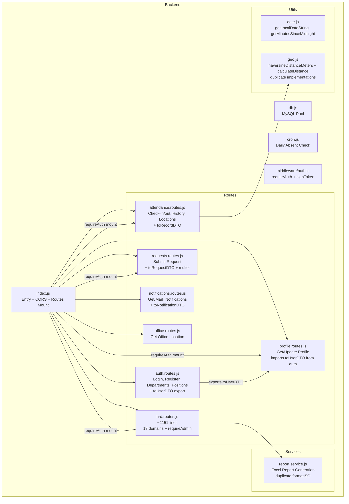
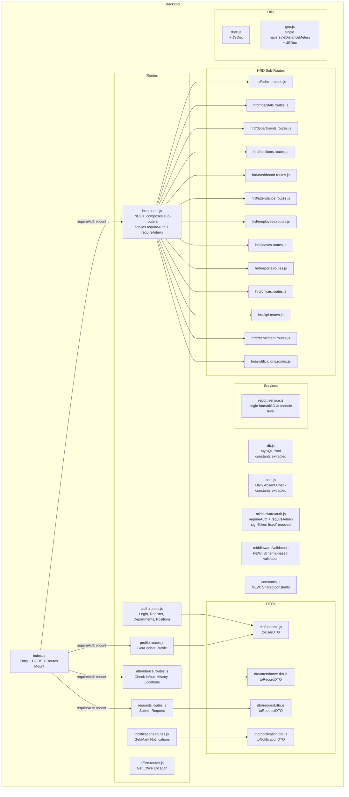

# Design Document: Code Cleanup

## Overview

This design document covers a comprehensive code cleanup pass across both the backend (`backend/`) and frontend (`frontend/`) projects of the PWA Absen CTI application. The cleanup is a pure refactoring task: no new features, no API changes, no behavioral changes. Every existing endpoint, UI page, and data flow must continue to work identically after cleanup.

The cleanup addresses 17 requirements grouped into five themes:

1. **Code hygiene** — Remove dead/commented-out code, unused imports, duplicate functions, redundant middleware
2. **Structural reorganization** — Split monolithic `hrd.routes.js` (~2151 lines) and `api.ts` (~300 lines) into domain-focused modules
3. **Consistency** — Fix JWT payload inconsistency, standardize error handling patterns, standardize commenting style, standardize API response formats
4. **Type safety** — Replace `any` types in frontend with proper TypeScript interfaces
5. **Tooling and documentation** — Extract magic numbers into named constants, add JSDoc/TSDoc, set up ESLint and Prettier, add input validation middleware

### Key Constraints

- **Zero behavioral changes**: All API endpoints must respond with identical status codes and response body shapes before and after cleanup.
- **Preserve all auth**: Every endpoint that was previously protected must remain protected after middleware consolidation.
- **Preserve all validation rules**: The validation layer must not add new rules that reject currently-accepted requests.
- **No new production dependencies**: Only devDependencies for linting/formatting tools are allowed.

### Research Summary

The codebase was analyzed file-by-file to understand the current structure, identify all magic numbers, dead code blocks, duplicate functions, redundant middleware, and type safety issues. Key findings:

- **HRD routes file** (`hrd.routes.js`) contains 13 distinct domain sections separated by `// =====` comment blocks, with a `requireAdmin` middleware defined inline and applied via `router.use(requireAuth, requireAdmin)` at the top.
- **`signToken`** in `auth.js` uses `{ sub: userId }` payload while all login routes use `{ id, role }` — `requireAuth` reads `payload.id` and `payload.role`, so tokens from `signToken` would fail auth. The function appears unused (no call sites found).
- **`formatISO`** is defined twice in `report.service.js`: once as a closure inside `hitungPeriode` and once at module level. The module-level one is used by `ambilData`.
- **`haversineDistanceMeters`** and **`calculateDistance`** in `geo.js` implement the same Haversine formula with slightly different parameter names (`lng` vs `lon`). Both are imported and used in `attendance.routes.js`.
- **Redundant `router.use(requireAuth)`** appears in `attendance.routes.js`, `requests.routes.js`, `notifications.routes.js`, `profile.routes.js`, and `office.routes.js` — all of which are also mounted with `requireAuth` in `index.js`.
- **`toUserDTO`** is defined in `auth.routes.js` and imported by `profile.routes.js`, creating a cross-route dependency.
- **Frontend `api.ts`** has 7 functions using `any` types for payloads and return values, primarily in HRD-related API calls.
- **Frontend `store.ts`** uses `any` casts in `fetchAllUserData` and `fetchHrdData`, calls `fetch` directly in `submitRequest` (bypassing the shared `request` helper), and has a commented-out `fetchAllUserData` block.

## Architecture

### Current Architecture



### Target Architecture



### Key Architectural Changes

| Change | Rationale |
|--------|-----------|
| Split `hrd.routes.js` into 13 domain sub-route files + index | Single-responsibility, each file <200 lines, easier to navigate |
| Extract DTOs into `backend/src/dto/` modules | Break cross-route import dependency (`profile.routes.js` → `auth.routes.js`) |
| Move `requireAdmin` to `middleware/auth.js` | Currently defined inline in `hrd.routes.js`; centralizing in middleware module makes it reusable and testable |
| Add `middleware/validate.js` | Replaces inline `if (!field)` validation blocks with schema-based middleware |
| Add `constants.js` | Centralizes shared magic numbers (JWT expirations, bcrypt rounds, body limit, pool limit, cron interval) |
| Split `api.ts` into domain modules + barrel export | Each file <100 lines, related functions grouped together |
| Frontend `lib/api/` subdirectory with barrel `index.ts` | Preserves existing import paths for pages and components |

## Components and Interfaces

### 1. Backend: HRD Routes Split

#### Directory Structure

```
backend/src/routes/
├── hrd.routes.js              # Index file: imports + composes sub-routers
├── hrd/
│   ├── admin.routes.js         # POST /admins/register
│   ├── hospitals.routes.js     # GET/POST/PUT/DELETE /hospitals
│   ├── departments.routes.js   # POST/PUT/DELETE /departments
│   ├── positions.routes.js      # POST/PUT/DELETE /positions
│   ├── dashboard.routes.js     # GET /dashboard/overview
│   ├── attendance.routes.js    # GET /attendance, /attendance-summary,
│   │                           # GET /attendance-daily-report,
│   │                           # GET /employee-report/:userId
│   ├── employees.routes.js     # GET/POST/PUT/DELETE /employees
│   ├── leaves.routes.js        # GET /leaves, PATCH /leaves/:id/approval
│   ├── reports.routes.js       # GET /reports/employees, /reports/export
│   ├── offices.routes.js       # GET/POST/PUT/DELETE /offices
│   ├── kpi.routes.js           # GET/POST /kpi, /kpi-templates/*, /kpi-dynamic/*
│   ├── recruitment.routes.js   # /recruitment/jobs/*, /recruitment/candidates/*
│   └── notifications.routes.js # POST/GET/DELETE /notifications
```

#### HRD Index File (`hrd.routes.js`)

The index file replaces the 2151-line monolith. It imports each sub-router and mounts them on a single `Router()` instance, applying `requireAuth` and `requireAdmin` centrally so all sub-routers inherit protection automatically.

```javascript
// hrd.routes.js — Index file that composes all HRD sub-routers
import { Router } from "express";
import { requireAuth, requireAdmin } from "../middleware/auth.js";
import adminRoutes from "./hrd/admin.routes.js";
import hospitalsRoutes from "./hrd/hospitals.routes.js";
// ... all other sub-route imports

const router = Router();

// Central auth: all HRD endpoints require admin access
router.use(requireAuth, requireAdmin);

// Mount sub-routers
router.use(adminRoutes);
router.use(hospitalsRoutes);
// ... mount all other sub-routers

export default router;
```

Each sub-route file exports a `Router()` instance with routes defined relative to `/api/hrd` (the mount prefix is applied in `index.js`, same as before). The sub-route files do NOT call `router.use(requireAuth)` or `router.use(requireAdmin)` — these are inherited from the index file.

#### Sub-Route File Template

Each sub-route file follows this pattern:

```javascript
/**
 * @fileoverview HRD Hospitals CRUD routes
 *
 * Endpoints:
 *   GET    /hospitals          - List all hospitals
 *   POST   /hospitals          - Create a hospital
 *   PUT    /hospitals/:id      - Update a hospital
 *   DELETE /hospitals/:id      - Delete a hospital
 */
import { Router } from "express";
import { pool } from "../../db.js";
import { randomUUID } from "crypto";
import { DEFAULT_HOSPITAL_RADIUS_METERS } from "../../constants.js";

const router = Router();

router.get("/hospitals", async (req, res) => { ... });
router.post("/hospitals", async (req, res) => { ... });
router.put("/hospitals/:id", async (req, res) => { ... });
router.delete("/hospitals/:id", async (req, res) => { ... });

export default router;
```

#### Shared Helper Migration

The `getIndonesianDayName` function currently defined inline in `hrd.routes.js` (used by the employee-report endpoint) moves to `hrd/attendance.routes.js` since it's only used there. The `requireAdmin` function moves to `middleware/auth.js` where it joins `requireAuth` and `signToken`.

### 2. Backend: DTO Extraction

DTO functions are extracted from route files into dedicated modules to break cross-route dependencies:

```
backend/src/dto/
├── user.dto.js           # toUserDTO (from auth.routes.js)
├── attendance.dto.js     # toRecordDTO (from attendance.routes.js)
├── request.dto.js        # toRequestDTO (from requests.routes.js)
└── notification.dto.js   # toNotificationDTO (from notifications.routes.js)
```

Each DTO module exports its function and includes a JSDoc comment documenting the input row shape and output object shape. Route files import from the DTO modules instead of from each other:

```javascript
// Before (profile.routes.js)
import { toUserDTO } from "./auth.routes.js";

// After
import { toUserDTO } from "../dto/user.dto.js";
```

### 3. Backend: Validation Middleware

A reusable schema-based validation middleware in `backend/src/middleware/validate.js`:

```javascript
/**
 * Creates an Express middleware that validates request fields against a schema.
 *
 * @param {Object} schema - Validation schema
 * @param {Object} [schema.body] - Field definitions for req.body
 * @param {Object} [schema.query] - Field definitions for req.query
 * @param {Object} [schema.params] - Field definitions for req.params
 * @param {string} schema.body.<field>.type - Expected type: 'string'|'number'|'boolean'
 * @param {boolean} [schema.body.<field>.required] - Whether the field is required
 * @returns {import('express').RequestHandler} Express middleware
 *
 * @example
 * router.post("/hospitals", validate({
 *   body: {
 *     name: { type: 'string', required: true },
 *     address: { type: 'string', required: true },
 *     latitude: { type: 'number', required: true },
 *     longitude: { type: 'number', required: true },
 *   }
 * }), async (req, res) => { ... });
 */
export function validate(schema) {
  return (req, res, next) => {
    const errors = [];
    // ... validation logic
    if (errors.length > 0) {
      return res.status(400).json({ message: errors.join(", ") });
    }
    next();
  };
}
```

**Design decisions:**

- **No external validation library** (e.g., Joi, Zod): The existing validation is simple field-presence and type checks. Adding a library would introduce a new production dependency, which is disallowed. A lightweight inline validator is sufficient.
- **Error message format**: Joins field-level errors into a single `message` string to match the existing response convention `{ message: "..." }`.
- **Preserves existing rules**: The schema must replicate exactly what the current inline `if (!field)` checks enforce — no more, no less.

### 4. Backend: Constants Extraction

Shared constants in `backend/src/constants.js`:

```javascript
// Body size limit for JSON requests (MB)
export const BODY_LIMIT_MB = 20;

// Default radius for hospital geofencing (meters)
export const DEFAULT_HOSPITAL_RADIUS_METERS = 200;

// Bcrypt salt rounds for password hashing
export const BCRYPT_SALT_ROUNDS = 10;

// Cron job configuration
export const CRON_CHECK_INTERVAL_MS = 10 * 60 * 1000; // 10 minutes
export const CRON_TARGET_HOUR = 23;
export const CRON_TARGET_MINUTE = 50;

// JWT expiration times
export const JWT_EMPLOYEE_EXPIRES_IN = "7d";
export const JWT_ADMIN_EXPIRES_IN = "12h";

// Database connection pool
export const DB_POOL_LIMIT = 10;

// Check-in window (minutes before/after shift start)
export const CHECKIN_WINDOW_MINUTES = 10;
```

File-specific constants remain at the module level in their respective files (e.g., `MAX_ACCURACY_METERS` in `attendance.routes.js` is already extracted).

### 5. Backend: Middleware Auth Fixes

**`signToken` fix**: The function uses `{ sub: userId }` but `requireAuth` reads `payload.id` and `payload.role`. Since no code calls `signToken` (verified by searching all route files), the function should be removed entirely. If any future code needs JWT signing, it should use the same `{ id, role }` payload structure that login routes use.

**`requireAdmin` extraction**: Move the `requireAdmin` function from `hrd.routes.js` inline definition to `middleware/auth.js`:

```javascript
// middleware/auth.js
export async function requireAdmin(req, res, next) {
  try {
    const [rows] = await pool.query("SELECT role FROM users WHERE id = ?", [req.userId]);
    if (rows.length === 0 || rows[0].role !== 'ADMIN') {
      return res.status(403).json({ message: "Access denied Admins/HRD only." });
    }
    next();
  } catch (err) {
    res.status(500).json({ message: "Internal server error." });
  }
}
```

### 6. Backend: Duplicate Function Consolidation

**`formatISO` in `report.service.js`**: Remove the closure-defined `formatISO` inside `hitungPeriode` and use the module-level `formatISO` in both `hitungPeriode` and `ambilData`. The module-level definition at the bottom of the file should be moved to the top (before `hitungPeriode`) so it's available to both functions.

**`haversineDistanceMeters` / `calculateDistance` in `geo.js`**: Consolidate into a single `haversineDistanceMeters` function. The two implementations are mathematically identical (Haversine formula). Update all call sites in `attendance.routes.js`:

```javascript
// Before
import { haversineDistanceMeters, calculateDistance } from "../utils/geo.js";
// ...
distance = haversineDistanceMeters(Number(lat), Number(lng), ...);
distanceMeters = calculateDistance(latitude, longitude, ...);

// After
import { haversineDistanceMeters } from "../utils/geo.js";
// ...
distance = haversineDistanceMeters(Number(lat), Number(lng), ...);
distanceMeters = haversineDistanceMeters(latitude, longitude, ...);
```

### 7. Frontend: API Module Split

#### Directory Structure

```
frontend/src/lib/
├── api/
│   ├── shared.ts            # ApiError class, request helper, token functions, getUploadUrl
│   ├── auth.api.ts           # apiRegister, apiLogin, apiGetMe, apiGetDepartments, apiGetPositions
│   ├── attendance.api.ts     # apiGetTodayAttendance, apiGetAttendanceHistory, apiCheckIn, apiCheckOut, apiGetAttendanceLocations, GeoPayload type
│   ├── requests.api.ts       # apiGetRequests, apiSubmitRequest
│   ├── notifications.api.ts  # apiGetNotifications, apiMarkNotificationRead
│   ├── profile.api.ts        # apiUpdateProfile
│   ├── office.api.ts         # apiGetOffice
│   ├── hrd.api.ts            # All HRD API functions (hospitals, employees, attendance, KPI, recruitment, etc.)
│   └── index.ts             # Barrel export: re-exports all functions and types
├── fcm.ts
├── geo.ts
├── image.ts
├── offlineQueue.ts
└── utils.ts
```

#### Barrel Export (`api/index.ts`)

```typescript
// Re-export shared utilities
export { ApiError, getToken, setToken, clearToken, getUploadUrl } from "./shared";
export type { GeoPayload } from "./attendance.api";

// Re-export all API functions by domain
export * from "./auth.api";
export * from "./attendance.api";
export * from "./requests.api";
export * from "./notifications.api";
export * from "./profile.api";
export * from "./office.api";
export * from "./hrd.api";
```

Existing imports in pages and components (`import { apiLogin } from "../lib/api"`) continue to work because the barrel `index.ts` sits at `lib/api/index.ts`, which resolves from `lib/api` — but the current import path is `../lib/api`. To preserve this, the old `api.ts` file should be replaced with a re-export barrel:

```typescript
// lib/api.ts — Re-export barrel (preserves existing import paths)
export * from "./api/index";
```

This approach means existing `import { apiLogin } from "../lib/api"` imports continue to resolve to `lib/api.ts`, which re-exports from `lib/api/index.ts`.

### 8. Frontend: TypeScript Type Fixes

New interfaces added to `frontend/src/types.ts`:

```typescript
// --- HRD Employee payloads ---

export interface CreateEmployeePayload {
  name: string;
  email: string;
  nik?: string;
  employee_id?: string;
  phone?: string;
  password?: string;
  id_department?: string;
  id_position?: string;
  department?: string;
  position?: string;
  address?: string;
  emergency_contact?: string;
  photo_url?: string;
  role?: 'EMPLOYEE' | 'ADMIN';
  jam_masuk?: string;
  jam_keluar?: string;
}

export interface UpdateEmployeePayload extends Partial<CreateEmployeePayload> {
  name?: string;
  email?: string;
  phone?: string;
  address?: string;
}

// --- KPI types ---

export interface KpiRecord {
  user_id: string;
  month_year: string;
  terlambat_laporan: number;
  laporan_tidak_sesuai: number;
  komplain: number;
  target_persen: number;
  pelanggaran_sop: number;
  // ... other KPI fields as returned by GET /hrd/kpi
}

export interface UpdateKpiPayload {
  user_id: string;
  month_year: string;
  terlambat_laporan?: number;
  laporan_tidak_sesuai?: number;
  komplain?: number;
  target_persen?: number;
  pelanggaran_sop?: number;
}

export interface KpiTemplate {
  id: string;
  nama_halaman: string;
  target_bagian: string;
  skema_kolom: string[];
  created_at?: string;
  updated_at?: string;
}

export interface KpiDynamicEvaluation {
  id_karyawan: string;
  nama_karyawan?: string;
  nilai_custom: Record<string, number | string>;
}

export interface KpiDynamicResponse {
  template: KpiTemplate;
  periode: string;
  evaluations: KpiDynamicEvaluation[];
}

// --- Employee report types ---

export interface IncidentDetail {
  date: string;
  dayName: string;
  category: string;
  categoryLabel: string;
  checkInTime?: string;
  checkOutTime?: string;
  workingHours?: number | null;
  keterangan?: string;
  status?: string;
}

export interface EmployeeReportResponse {
  employee: {
    id: string;
    name: string;
    employeeId: string;
    department: string;
    position?: string;
    email?: string;
    phone?: string;
  };
  summary: {
    totalIzin: number;
    totalCuti: number;
    totalTelat: number;
    totalHadir: number;
    totalHariAktif?: number;
  };
  periode: string;
  details: IncidentDetail[];
  incidentDetails: IncidentDetail[];
}

// --- Candidate update payload ---

export interface UpdateCandidatePayload {
  name?: string;
  stage?: 'SCREENING' | 'INTERVIEW' | 'HIRED' | 'REJECTED';
  job_opening_id?: string;
  notes?: string;
}
```

### 9. Frontend: Store Cleanup

Changes to `frontend/src/store.ts`:

1. **Remove `id` import** from `date-fns/locale` (unused).
2. **Remove commented-out `fetchAllUserData` block** (dead code, lines 57-70).
3. **Type the response variables**: Replace `const historyRes: any` with `const historyRes: { records: AttendanceRecord[] }` and similarly for all other `any` casts in `fetchAllUserData` and `fetchHrdData`.
4. **Replace `submitRequest` direct `fetch`**: Use `apiSubmitRequest` from the API layer. However, `submitRequest` currently uses `FormData` (multipart upload with file attachment), while `apiSubmitRequest` uses JSON. This requires updating `apiSubmitRequest` to support multipart upload, or keeping the `fetch` call but routing it through a shared request helper that handles FormData. Design decision: keep the `fetch` call but extract it into a `requestFormData` helper in `shared.ts` that mirrors the `request` helper's auth and error handling, ensuring consistent error handling without breaking the multipart upload.

### 10. Frontend: Constants Extraction

Magic numbers in `frontend/src/lib/image.ts`:

```typescript
// Maximum width for compressed images (pixels)
const IMAGE_MAX_WIDTH_PX = 800;

// JPEG compression quality (0-1)
const IMAGE_COMPRESSION_QUALITY = 0.7;

export function compressImageFile(
  file: File,
  maxWidth: number = IMAGE_MAX_WIDTH_PX,
  quality: number = IMAGE_COMPRESSION_QUALITY,
): Promise<string> { ... }
```

### 11. ESLint and Prettier Configuration

#### Backend ESLint (`eslint.config.js`)

Flat config format for an Express.js + ES Modules project:

```javascript
import js from "@eslint/js";

export default [
  js.configs.recommended,
  {
    languageOptions: {
      ecmaVersion: 2024,
      sourceType: "module",
    },
    rules: {
      // Warnings for existing style issues to avoid blocking the build
      "no-unused-vars": "warn",
      "no-console": "off",
      "prefer-const": "warn",
    },
  },
  {
    ignores: ["node_modules/", "uploads/"],
  },
];
```

#### Frontend ESLint (`eslint.config.js`)

Flat config for React + TypeScript + Vite:

```javascript
import js from "@eslint/js";
import tseslint from "typescript-eslint";
import reactHooks from "eslint-plugin-react-hooks";

export default tseslint.config(
  js.configs.recommended,
  ...tseslint.configs.recommended,
  {
    plugins: {
      "react-hooks": reactHooks,
    },
    rules: {
      ...reactHooks.configs.recommended.rules,
      "@typescript-eslint/no-explicit-any": "warn",
      "@typescript-eslint/no-unused-vars": "warn",
    },
  },
  {
    ignores: ["dist/", "node_modules/"],
  },
);
```

#### Prettier Configuration (both projects)

`.prettierrc` matching the existing codebase style (2-space indent, double quotes, semicolons):

```json
{
  "semi": true,
  "singleQuote": false,
  "tabWidth": 2,
  "printWidth": 100,
  "trailingComma": "es5"
}
```

#### Package.json Scripts (both projects)

```json
{
  "scripts": {
    "lint": "eslint .",
    "format": "prettier --write \"src/**/*.{js,ts,tsx}\""
  }
}
```

#### Ignore Files (both projects)

`.eslintignore` and `.prettierignore`:
```
node_modules/
dist/
build/
uploads/
*.min.js
```

## Data Models

### Backend JSDoc Type Definitions

JSDoc `@typedef` annotations for database row shapes used by DTO functions:

```javascript
/**
 * @typedef {Object} UserRow
 * @property {string} id
 * @property {string} employee_id
 * @property {string} nik
 * @property {string} name
 * @property {string} email
 * @property {string} phone
 * @property {string} department
 * @property {string} position
 * @property {string} jam_masuk
 * @property {string} jam_keluar
 * @property {string} photo_url
 * @property {string} emergency_contact
 * @property {string} address
 * @property {'EMPLOYEE'|'ADMIN'} role
 */

/**
 * @typedef {Object} UserDTO
 * @property {string} id
 * @property {string} employeeId
 * @property {string} nik
 * @property {string} name
 * @property {string} department
 * @property {string} position
 * @property {string} phone
 * @property {string} email
 * @property {string} schedule
 * @property {string|null} jamMasuk
 * @property {string|null} jamKeluar
 * @property {string} photoUrl
 * @property {string} emergencyContact
 * @property {string} address
 * @property {'EMPLOYEE'|'ADMIN'} role
 */
```

### Validation Schema Model

The validation middleware accepts a schema definition object:

```javascript
/**
 * @typedef {Object} FieldRule
 * @property {'string'|'number'|'boolean'} type
 * @property {boolean} [required] - Whether the field is required (default: false)
 */

/**
 * @typedef {Object} ValidationSchema
 * @property {Record<string, FieldRule>} [body] - Rules for req.body fields
 * @property {Record<string, FieldRule>} [query] - Rules for req.query fields
 * @property {Record<string, FieldRule>} [params] - Rules for req.params fields
 */
```

### Frontend TypeScript Interface Model

The new interfaces defined in `types.ts` (see Components and Interfaces section 8) follow the existing pattern of the `types.ts` file: exported `type` or `interface` declarations with JSDoc comments. The interfaces are organized by domain: employee management, KPI, reports, and recruitment.


## Correctness Properties

*A property is a characteristic or behavior that should hold true across all valid executions of a system — essentially, a formal statement about what the system should do. Properties serve as the bridge between human-readable specifications and machine-verifiable correctness guarantees.*

This refactoring task involves primarily structural changes (file splitting, dead code removal, documentation, tooling). However, several requirements involve pure functions and logic that are amenable to property-based testing:

1. **JWT token signing/verification** (Requirement 5) — a pure function round-trip
2. **Haversine distance calculation** (Requirement 6) — a pure mathematical function
3. **Validation middleware** (Requirement 17) — a pure function of (schema, request) → (valid, errors)

The remaining requirements (dead code removal, file splitting, ESLint config, JSDoc, commenting style, constant extraction) are verified through smoke tests, static analysis, and integration tests rather than property-based testing.

### Property 1: JWT round-trip consistency

*For any* valid userId string and role value (`'EMPLOYEE'` or `'ADMIN'`), signing a JWT with `{ id, role }` payload using the application's JWT secret and then verifying that token with `requireAuth`'s verification logic SHALL produce the same `id` and `role` values. After cleanup, the `signToken` function (which used `{ sub: userId }`) is removed, ensuring all token-signing locations use the consistent `{ id, role }` payload that `requireAuth` reads.

**Validates: Requirements 5.1, 5.2**

### Property 2: Haversine distance correctness

*For any* four numeric coordinate values (lat1, lng1, lat2, lng2), the consolidated `haversineDistanceMeters` function SHALL return the same distance value as the original `calculateDistance` function and the standard Haversine formula. After consolidating the two duplicate implementations into one, all call sites in `attendance.routes.js` receive identical results.

**Validates: Requirements 6.2, 6.3**

### Property 3: Validation utility correctness

*For any* validation schema (with required/optional fields of type string/number/boolean) and *for any* request body, the validation middleware SHALL correctly distinguish valid from invalid inputs: when all required fields are present with correct types, the middleware calls `next()` to proceed; when any required field is missing or has an incorrect type, the middleware returns a 400 response with a `message` field listing the specific validation errors.

**Validates: Requirements 17.2, 17.3, 17.6**

### Property 4: Validation rule preservation

*For any* request body submitted to an endpoint that previously used inline validation checks (e.g., `if (!name || !email)`), the new schema-based validation utility SHALL produce the same accept/reject decision as the original inline check. No request that was previously accepted by the inline check is rejected by the schema validation, and no request that was previously rejected is accepted.

**Validates: Requirements 17.5, 17.7**

## Error Handling

### Standardized Error Handling Pattern

All backend route handlers follow a consistent try/catch pattern:

```javascript
router.post("/example", async (req, res) => {
  try {
    // Main logic
    res.status(200).json({ message: "...", data: ... });
  } catch (err) {
    // Expected errors: specific status codes
    if (err.code === 'ER_DUP_ENTRY') {
      return res.status(409).json({ message: "Email atau NIK sudah terdaftar." });
    }
    if (err.status) {
      return res.status(err.status).json({ message: err.message });
    }
    // Unexpected errors: 500 with generic message
    console.error("Error in /example:", err);
    res.status(500).json({ message: "Terjadi kesalahan pada server." });
  }
});
```

**Error handling rules:**

| Error Type | HTTP Status | Condition |
|------------|-------------|-----------|
| `ER_DUP_ENTRY` | 409 | Duplicate unique key constraint |
| `ER_DATA_TOO_LONG` | 413 | Data exceeds column length |
| Not found (affectedRows === 0) | 404 | Resource doesn't exist |
| Validation failure | 400 | Missing/invalid fields (via validation middleware) |
| Unauthorized | 401 | Missing/invalid JWT token |
| Forbidden | 403 | Non-admin accessing admin endpoint |
| Body too large | 413 | Request body exceeds 20MB limit |
| Unexpected | 500 | All other errors (logged to console.error) |

The global error handler in `index.js` serves as a last-resort catch for unhandled errors and the `entity.too.large` body size error.

### Frontend Error Handling

The `ApiError` class in `lib/api/shared.ts` provides structured error information:

```typescript
export class ApiError extends Error {
  status: number;
  code?: string;
  constructor(message: string, status: number, code?: string) {
    super(message);
    this.status = status;
    this.code = code;
  }
}
```

The shared `request` helper throws `ApiError` for non-OK responses, allowing UI code to catch and display server-provided error messages. The `submitRequest` function in `store.ts` is refactored to use a `requestFormData` helper that applies the same auth and error handling as the JSON `request` helper, ensuring consistent error handling for multipart uploads.

## Testing Strategy

### Dual Testing Approach

This refactoring uses three complementary testing approaches:

1. **Property-based tests** — Verify universal properties of pure functions (JWT, distance, validation)
2. **Unit/smoke tests** — Verify specific examples, structural changes, and configuration
3. **Integration tests** — Verify behavioral preservation across before/after comparison

### Property-Based Tests

Property-based testing is appropriate for the pure functions involved in this refactoring. The project uses **Vitest** (already in frontend devDependencies) which supports property-based testing via fast-check.

For the backend, a test runner needs to be set up. The backend currently has no test framework. **Vitest** is the recommended choice since the team already uses it in the frontend, and it supports ES modules natively.

**Configuration:**
- Minimum 100 iterations per property test
- Each test tagged with design property reference
- Tag format: `Feature: code-cleanup, Property {number}: {property_text}`

**Property tests to implement:**

| Test | Property | Framework | Target |
|------|----------|-----------|--------|
| JWT round-trip | Property 1 | Vitest + fast-check | `backend/tests/properties/jwt.test.js` |
| Haversine distance | Property 2 | Vitest + fast-check | `backend/tests/properties/geo.test.js` |
| Validation utility | Property 3 | Vitest + fast-check | `backend/tests/properties/validate.test.js` |
| Validation preservation | Property 4 | Vitest + fast-check | `backend/tests/properties/validate-preservation.test.js` |

**Example property test (Haversine distance):**

```javascript
import { describe, it, expect } from "vitest";
import fc from "fast-check";
import { haversineDistanceMeters } from "../../src/utils/geo.js";

// Feature: code-cleanup, Property 2: Haversine distance correctness
describe("Property 2: Haversine distance correctness", () => {
  it("should return the same result for any coordinate pair", () => {
    fc.assert(
      fc.property(
        fc.float({ min: -90, max: 90, noNaN: true }),
        fc.float({ min: -180, max: 180, noNaN: true }),
        fc.float({ min: -90, max: 90, noNaN: true }),
        fc.float({ min: -180, max: 180, noNaN: true }),
        (lat1, lng1, lat2, lng2) => {
          const result = haversineDistanceMeters(lat1, lng1, lat2, lng2);
          // Verify result is a non-negative finite number
          return typeof result === "number" && result >= 0 && Number.isFinite(result);
        }
      ),
      { numRuns: 100 }
    );
  });

  it("should be symmetric: d(a,b) === d(b,a)", () => {
    fc.assert(
      fc.property(
        fc.float({ min: -90, max: 90, noNaN: true }),
        fc.float({ min: -180, max: 180, noNaN: true }),
        fc.float({ min: -90, max: 90, noNaN: true }),
        fc.float({ min: -180, max: 180, noNaN: true }),
        (lat1, lng1, lat2, lng2) => {
          return haversineDistanceMeters(lat1, lng1, lat2, lng2) ===
                 haversineDistanceMeters(lat2, lng2, lat1, lng1);
        }
      ),
      { numRuns: 100 }
    );
  });
});
```

### Unit and Smoke Tests

These verify specific examples, structural changes, and configuration:

| Category | What's Verified | Tool |
|----------|----------------|------|
| Dead code removal | No commented-out blocks >3 lines, signToken import removed | Static scan script |
| HRD route split | All 13 sub-route files exist, index composes them, header comments present | File existence checks |
| Redundant middleware | No route file with redundant `router.use(requireAuth)`, `/locations` route-level auth removed | Static scan |
| Unused imports | No unused imports (ESLint `no-unused-vars`), dotenv removed from db.js | ESLint |
| TypeScript types | No `any` types in api.ts functions, store.ts uses typed responses | `tsc --noEmit` |
| API module split | All domain modules exist, barrel re-exports all functions | Import resolution test |
| Error handling | All route handlers have try/catch | Static scan |
| Commenting style | Consistent language (Indonesian), format, separator length | ESLint custom rules / scan |
| Constants extraction | All magic numbers replaced with named constants, correct values | Static scan |
| JSDoc/TSDoc | All exported functions documented | JSDoc validation |
| ESLint/Prettier | Config files exist, correct format, scripts added, ignore files present | Config validation |
| Store cleanup | No `any` casts, submitRequest uses helper, dead code removed | `tsc --noEmit` + static scan |

### Integration Tests

These verify behavioral preservation — the most critical aspect of the refactoring:

| Test | What's Verified | Approach |
|------|----------------|----------|
| API endpoint preservation | All HRD endpoints respond with same status codes and body shapes | Before/after response comparison |
| Auth flow preservation | Login, session hydration, protected routes work identically | End-to-end auth test |
| Response format preservation | Success and error responses match pre-cleanup shapes | Response shape comparison |
| No runtime errors | Application runs without new errors | Manual + automated smoke test |

**Integration test approach for behavioral preservation:**

For each API endpoint, record the pre-cleanup response for a set of representative request payloads. After cleanup, send the same payloads and compare responses. This can be automated with a snapshot-style comparison test that records expected responses before the refactoring and verifies them after.

### Frontend Build Verification

```bash
# Verify TypeScript compilation
cd frontend && npx tsc --noEmit

# Verify production build
cd frontend && npm run build

# Run existing tests
cd frontend && npx vitest --run
```

### Backend Test Setup

The backend currently has no test framework. Setting up Vitest for backend property tests:

```json
// backend/package.json (devDependencies addition)
{
  "devDependencies": {
    "vitest": "^4.1.9",
    "fast-check": "^4.2.0"
  },
  "scripts": {
    "test": "vitest run",
    "test:properties": "vitest run tests/properties"
  }
}
```

```javascript
// backend/vitest.config.js
import { defineConfig } from "vitest/config";

export default defineConfig({
  test: {
    globals: true,
    environment: "node",
  },
});
```

### Testing Scope Summary

| Requirement | Test Type | Count |
|-------------|-----------|-------|
| 1 (Dead code) | Smoke | 3 |
| 2 (HRD split) | Smoke + Integration | 5 |
| 3 (Redundant middleware) | Smoke + Integration | 4 |
| 4 (Unused imports) | Smoke | 5 |
| 5 (JWT payload) | **Property** + Example | 3 |
| 6 (Duplicate functions) | **Property** + Smoke | 3 |
| 7 (TS types) | Smoke (tsc) | 9 |
| 8 (API split) | Smoke | 4 |
| 9 (Error handling) | Smoke + Integration | 4 |
| 10 (Commenting) | Smoke | 3 |
| 11 (Store cleanup) | Smoke | 4 |
| 12 (No behavioral change) | Integration | 5 |
| 13 (Constants) | Example | 10 |
| 14 (JSDoc/TSDoc) | Smoke | 8 |
| 15 (ESLint/Prettier) | Smoke | 9 |
| 16 (Response formats) | Integration | 6 |
| 17 (Validation) | **Property** + Smoke | 8 |
